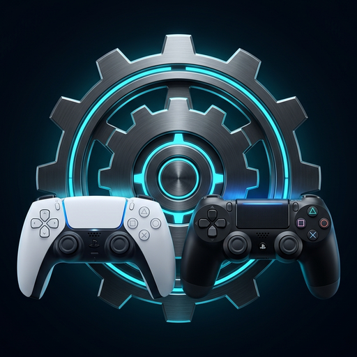

# 🎮 Controller Control Center PS4

<p align="center">
  
</p>

<h2 align="center">Centro de Control de Mandos PS5 DualSense, DualShock 4 y USB/BT HID para PlayStation 4</h2>

<p align="center">
  <b>Aplicación Homebrew PS4 (Title ID: <code>TONI88888</code>) + Demonio/Payload <code>ANYCONTROLLER</code> (<code>anycontroller.bin</code>)</b>
</p>

<p align="center">
  
  
  
  
  
</p>

---

## 📋 Descripción General

**Controller Control Center PS4** es una suite Homebrew a **1080p / 60 FPS** para consolas **PlayStation 4** con **GoldHEN**, impulsada en segundo plano por el demonio **`ANYCONTROLLER`** (`/data/payloads/anycontroller.bin`).

Permite conectar y personalizar múltiples mandos **Sony DualSense / DualSense Edge (PS5)** por Bluetooth nativo o USB, ajustar mandos **DualShock 4 (PS4)** y usar mandos **Xbox, Nintendo Switch y genéricos USB HID** con **sondeo a 250 Hz (4 ms)**.

---

## ✨ Novedades Destacadas (`v1.5.4`)

- **Conexión Instantánea de DualSense en Arranque en Frío (`vpad_prewarm_subsystem`):**
  - Pre-inicialización de `libSceMbus.sprx`, `libScePad.sprx` y `libSceUserService.sprx` al arrancar el demonio en GoldHEN antes de encender cualquier mando, eliminando la demora de minutos al mostrar la pantalla nativa `¿Quién está usando este mando?` tras días sin encender la PS4.
- **Filtro `suppress_poweron_ps` + Reintento Inteligente Multi-Etapa:**
  - Suprime la retención física del botón PS de encendido antes y después del pulso corto de `160 ms` (a los `150 ms` de conectar) hasta que el usuario suelta físicamente el botón PS, garantizando que `SceShellUI` nunca confunda el encendido del mando con una pulsación larga de Menú Rápido.
  - Añade respaldo automático a los `+1.5 s` y `+3.3 s` en todas las ranuras no vinculadas si `SceShellUI` estaba ocupado cerrando el navegador/exploit.
- **Estabilidad Bluetooth DualSense 1 + 2 y Colores DualShock 4:**
  - Sondeo de enlace de `4 ms` tras el evento `0x18`, aplicación del parche de `78 bytes` tras el primer paquete HID real, y preservación de sesión en micro-cortes sin pulsar PS accidentalmente.

---

## 📦 Instalación en PlayStation 4 (GoldHEN)

1. Descarga **`Controller_Control_Center_PS4_v1.5.4.pkg`** desde [**Releases**](https://github.com/toniigibertt/AnyController-PS4/releases).
2. Copia el `.pkg` a la raíz de un USB (exFAT / FAT32) o envíalo por FTP a `/data/pkg/`.
3. En tu PS4, abre **Ajustes → GoldHEN → Package Installer** e instala **`Controller_Control_Center_PS4_v1.5.4.pkg`**.
4. Inicia **Controller Control Center PS4** desde el menú XMB. En el primer arranque se configurará automáticamente:
   - Payload **`ANYCONTROLLER`** en `/data/payloads/anycontroller.bin`
   - Configuración Global en `/data/anycontroller/anycontroller.ini`
   - Perfiles por mando en `/data/anycontroller/controllers/`
   - Arranque automático en `/data/GoldHEN/payloads.ini` bajo `[AutoRun]`

---

## 🛠️ Compilación desde el Código Fuente

### Requisitos (Linux / WSL)
- **OpenOrbis PS4 Toolchain** (`OO_PS4_TOOLCHAIN` en `/opt/OpenOrbis/PS4Toolchain`)
- `clang`, `clang++`, `ld.lld`, `python3`

### Pasos de compilación
```bash
# 1. Compilar el demonio ANYCONTROLLER (genera ps4_source/bin/anycontroller.bin)
bash ps4_source/build_daemon.sh

# 2. Compilar la app y empaquetar el PKG versionado (Controller_Control_Center_PS4_v1.5.4.pkg)
bash ps4_source/build_app.sh
```

### Aplicación Web Companion (Configurador .INI y descargas)
```bash
npm install
npm run dev
```

---

## 📁 Rutas en la Consola PS4

| Ruta en la Consola PS4 | Descripción |
| :--- | :--- |
| `/data/payloads/anycontroller.bin` | Payload del demonio **ANYCONTROLLER** cargado por GoldHEN |
| `/data/anycontroller/anycontroller.ini` | Configuración Global predeterminada |
| `/data/anycontroller/controllers/ds_mac_<MAC>.ini` | Memoria persistente independiente por dirección MAC de DualSense |
| `/data/anycontroller/controllers/ds4_slot_<1..4>.ini` | Configuración independiente por ranura de DualShock 4 |
| `/data/anycontroller/controllers/<VID>_<PID>.ini` | Mapeo personalizado de botones USB HID |
| `/data/GoldHEN/payloads.ini` | Registro `[AutoRun]` de GoldHEN |
| `/data/pkg/Controller_Control_Center_PS4_*.pkg` | Paquetes descargados por el actualizador integrado |
